<!-- Generated from report_draft.tex by draft_to_markdown.py: edit the .tex, then rerun. -->

# Which cropland is under water? Checking the public maps behind a flood trigger in South Sudan

*Group 1, JBG060. Draft, 14 October 2026.* Marks: **[...]** still to write or make; *(pending decision N)* waits for the group (REVIEW_PLAN.md); > **Idea.** suggestions for cutting.

## 1. Context / Problem Background / Motivation of Analysis

Floods hit South Sudan every year, and since 2019 they have been the largest in the satellite record. ZOA International wants to act before a flood damages livelihoods: anticipatory action. It works in two flood-prone areas, the five Aweil counties along the Lol river and Bor South on the White Nile (ZOA International and Zero Hunger Lab, 2026). About 80% of rural communities there live mainly from farming, and the impact ZOA names first is a harvest lost to flooding. Its example trigger is "a flood which inundates cropland resulting in at least y% of total yield reduction".

Such a trigger multiplies two maps: where the water will be, and where the fields are (Pacetti et al., 2017). Most effort goes into the first. The second is taken from one of several free, global cropland maps, and ZOA itself suspects that the data "might not capture agricultural land fully". Nobody has checked these maps in South Sudan: the two largest accuracy studies of African cropland maps leave the country out (Kerner et al., 2024; Adebayo et al., 2026). Where those studies did look, maps often failed exactly where crop is rare. In Mali, the Esri map reaches an overall accuracy of 0.97 with an F1 of 0.00, because it calls almost nothing crop.

In ZOA's areas the maps disagree so much that the cropland map, not the flood, decides whether a trigger fires. For the 2022 flood, the same overlay gives 432 or 5,805 ha of flooded cropland in Aweil, depending only on which map is used. A trigger built on such a number cannot be trusted until someone measures how much cropland there is, with an honest error bar, and how wrong each map is there. That is what this project does.

## 2. Business and Data Understanding

**The decision.** ZOA's anticipatory action follows a chain: a forecast, a pre-agreed trigger, and early action such as cash transfers, temporary flood defences and early harvesting (ZOA International and Zero Hunger Lab, 2026; Anticipation Hub, 2023). Cropland enters at three points. It sets whether the trigger fires (how much cropland lies under the forecast water), how large a funding request is (hectares to households to cash), and who is reached (whose fields are on the map). ZOA asks for numbers with a stated certainty, and warns about both kinds of error: a miss leaves people without help on time, and a false alarm spends scarce resources and costs trust. Zero Hunger Lab supports ZOA with data analysis and asked what public data can and cannot tell them.

**Prior work.** Kerner et al. (2024) scored 11 public cropland maps against labelled points in eight African countries. Mean F1 per country ranged from 0.21 to 0.71, land that all maps call crop covered under 0.5% of every country, and overall accuracy misled wherever crop was rare. Adebayo et al. (2026) turned map accuracy into the number of labelled points an area estimate needs (relative efficiency) and showed that, for a rare class, a map's recall matters most. Both studies estimate area from a stratified probability sample (Olofsson et al., 2014; Stehman, 2014): a design that stays unbiased whatever the quality of the maps, unlike counting a map's pixels.

**Data.** Table 1 lists the data. The course provided NASA MCDWD flood masks (NASA LANCE, 2025), the ASAP crop mask (Fritz et al., 2024) and county boundaries. We added seven public cropland maps (Zanaga et al., 2022; Potapov et al., 2022; Burton et al., 2022; Van Tricht et al., 2023; Karra et al., 2021; Brown et al., 2022; Thenkabail et al., 2021), Sentinel-1 and Sentinel-2 images and dated sub-metre imagery to label points, and the FAO/WFP crop assessments (FAO and WFP, 2023; FAO and WFP, 2026), whose cereal area is modelled from population and household figures, not observed.

**How the public maps differ.** The seven maps answer different questions (Table 2). They show different years, from 2015 to 2025, so a field opened or left since then is right in one map and wrong in another. They define crop differently: GLAD, GFSAD and Esri count fallow plots as crop, while WorldCover, DE Africa and WorldCereal count land sown and harvested within a year. And they are built differently. WorldCover, WorldCereal, DE Africa, GLAD and GFSAD train classifiers per region on a year of satellite images, so the seasonal rhythm of a field (bare, green, harvested) can enter the model. Esri and Dynamic World run one global deep network on single Sentinel-2 images and combine the answers over the year, which makes them good at shapes such as large rectangular fields and weak at small fields that look like grass in any one image. ASAP is a merge of older maps at about 500 m. As far as we found, none was trained or checked on fields in South Sudan. We read each map as crop or not crop as Kerner et al. (2024) do (last column).

**What the data show.** The maps tell seven stories. In the Aweil counties they call between 0.22% and 1.92% of the land crop, all below the crop assessment's cereal area (3.6%). In Bor South, Dynamic World calls 9.0% crop while no other map exceeds 0.25%. Where two maps do call crop, it is mostly different land: the best pair shares 0.16 of its crop area, the median pair 0.04 (Figure 1), and all seven agree on about 0.5 ha out of 3,085,318 ha. In a single 6 by 6 km window north of Aweil town, the maps call between 0.0% and 21.7% of the land crop, each in different places (Figure 2). The same pairs agree on 97-99% of all pixels, because most land is "not crop" everywhere. This is the problem in one number: agreement on empty land hides disagreement on fields. Appendix F shows the maps by county, by state against the crop assessment, and year by year.

**Terms.** *Precision* (user's accuracy) is the share of a map's crop that is really crop; *recall* (producer's accuracy) is the share of real crop the map finds; *F1* combines the two. A *stratum* is a part of the area sampled separately. *Cropland* means a box with a cropped or a fallow field; *cropped in 2025* counts cropped fields only.

*Table 1. Data used. Course data from Zero Hunger Lab; the rest collected by us.*

| Data | Use | Source |
|---|---|---|
| NASA MCDWD flood masks, 2000-2025, about 232 m | flooded cropland, 2025 and earlier floods | course |
| ASAP crop mask v04, about 500 m | one of the maps scored | course |
| County boundaries | study areas, totals | course |
| WorldCover 2021, GLAD 2019, DE Africa 2019, WorldCereal 2021, Esri 2025, Dynamic World 2025, GFSAD 2015 | strata, maps scored | Earth Engine |
| Sentinel-2 L2A, Sentinel-1, Esri sub-metre imagery | labelling, features | Earth Engine, Esri |
| Google Open Buildings v3, Satellite Embedding 2025 | features | Earth Engine |
| 450 points, two blind labels each, 2025 | reference sample | ours |
| FAO/WFP crop assessments 2022, 2025 | outside check | FAO/WFP |

*Table 2. The public maps: what each calls crop and how it is made (from each map's documentation), and how we read it as crop.*

| Map | Year | Pixel | Built with | Counts as crop | Crop when |
|---|---|---|---|---|---|
| ESA WorldCover v200 | 2021 | 10 m | Sentinel-1 and -2 over a year, gradient-boosted trees per region, expert rules | annual crops sown and harvested within 12 months | class 40 |
| GLAD cropland | 2019 | 30 m | Landsat metrics of 2016-2019, bagged decision trees per 1° tile | herbaceous crops; fallow up to four years counts | value >0.5 |
| Digital Earth Africa | 2019 | 10 m | Sentinel-2 over a year, random forest per agro-ecological zone | at least 0.01 ha sown and harvested within 12 months | value 1 |
| ESA WorldCereal | 2021 | 10 m | Sentinel-1 and -2 and weather, gradient-boosted trees per region and season | temporary crops | class 100 |
| Esri / Impact Observatory | 2025 | 10 m | single Sentinel-2 images, one global deep network | planted crops, fallow plots included | class 5 |
| Google Dynamic World | 2025 | 10 m | single Sentinel-2 images, one global deep network; we take the most frequent label of the year | planted crops | label 4 |
| GFSAD GCEP30 | 2015 | 30 m | Landsat, an ensemble of classifiers per zone | cultivated land, fallow and plantations | class 2 |
| ASAP crop mask v04 | 2017-23 | about 500 m | a merge of older maps | share of crop per cell | 5% or more |

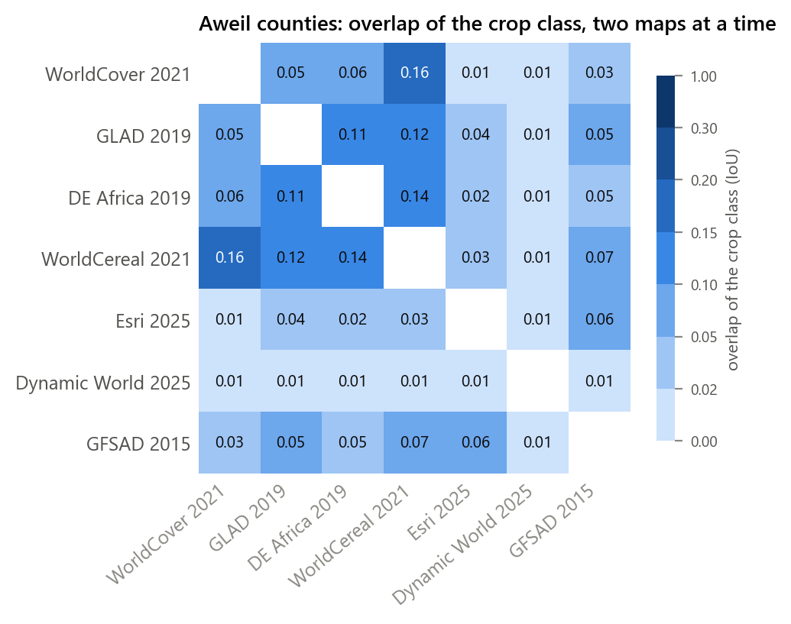

*Figure 1. Aweil counties: overlap of the crop class of every two public maps (intersection over union). The same pairs agree on 97-99% of all pixels, because most land is "not crop" in every map.*

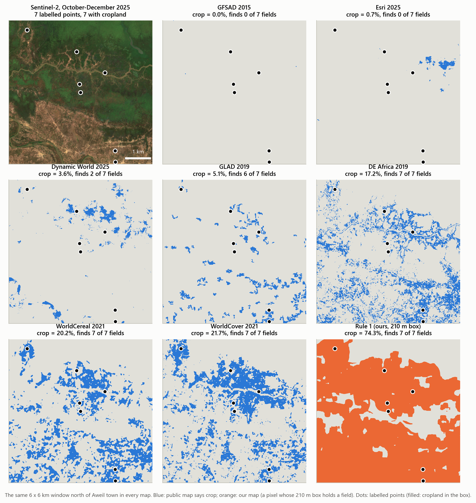

*Figure 2. The same 6 by 6 km window north of Aweil town in every map, 2025. Blue: the public map says crop; orange: our map (pixels whose 210 m box holds a field). Dots: the labelled points in the window, all with cropland. We chose the window with the most labelled points; it lies where several maps see crop, so the maps look better here than over Aweil as a whole (Figure 6).*

## 3. Research Objective

We estimate how much land in ZOA's two areas was cropland in the 2025 season, with a 95% interval that does not depend on any map; measure how accurately seven public maps, the course's ASAP mask and a readable map of our own capture that cropland there; and show how the choice of map changes the flooded-cropland number a trigger would use.

This breaks down into four measurable sub-objectives: (1) the cropland area of each study area, for cropland and for cropped in 2025, with a 95% interval; (2) precision, recall and F1 of every public map on held-out points, per area; (3) the same scores for a map built from rules a person can read; (4) flooded cropland under each map against the labelled sample, whether a trigger would fire, and how many points a yearly check needs.

**Scope and assumptions.** The reference is what two trained people see on satellite images; there were no field visits. One season (2025), two areas; results hold there only. A point stands for the 210 m box around it. Flood masks are taken as given; we do not forecast floods.

**An adequate solution** states its uncertainty, reports misses and false alarms separately, is readable and repeatable by local staff, and is judged where ZOA works (ZOA International and Zero Hunger Lab, 2026). Table 3 turns these into measures. The objective was feasible within the course: the sample was drawn, labelled twice and scored in four weeks.

## 4. Approach

The approach has four steps (Figure 3): draw a probability sample where the maps disagree, label it twice, build a readable map from it, and estimate area, accuracy and flooded cropland. The protocol was written and frozen before labelling; every later change is dated, with its reason, in a change log.

### Reference sample

We stacked the seven public maps on a 10 m grid and split each area by how many call a pixel crop: no map (stratum A, 95.0% of Aweil), one or two (B), three or more (C). Such agreement strata put points where the maps disagree and trust no single map (Kerner et al., 2024). We drew 450 random points at least 100 m apart: 150, 90 and 90 in Aweil's strata, 60 and 60 in Bor South (its stratum C was too small and was merged into B). Before anyone labelled, each stratum was split at random into one third calibration points (to build our map) and two thirds test points (to score every map).

### Labelling

Each point stands for the 210 m box around it: in a pilot of 30 points, five labellers could not judge a single 10 m pixel (kappa 0.00-0.38). Two of the five group members label every box, independently and blind to all maps. They see monthly Sentinel-2 images of 2025, a radar curve for the cloudy months and the most recent sub-metre image with its date; links open older sub-metre images (Esri Wayback) and Google's imagery, whose date is not shown. A written key asks for four cues: bare soil before sowing, green-up, harvest earlier than the surrounding grass, and field shape. A box is *crop* if any field in it was cropped in 2025, *fallow* if it holds a field that was not, and *not crop* otherwise; the labeller also estimates the share of the box that is cropland (none, under 10%, 10-25%, 25-50%, over 50%). Disagreements are kept, not settled by a third person: a split point counts half in the area and is left out of accuracy.

### Features

For every box we computed 18 features in Google Earth Engine (Table 9). Each is computed per 10 m pixel for 2025, from cloud-masked monthly Sentinel-2 composites (Cloud Score+), Sentinel-1 radar (descending passes, the only ones over South Sudan in 2025), JRC surface water, MODIS burned area and Google Open Buildings, and then summarised over the 210 m box by its most crop-like part: the 10th percentile for the lowest spring greenness and the distance to buildings, the 90th percentile for bare soil, green-up, the harvest drops, texture and edges, and the mean for the rest. A feature thus describes the same box the labeller judged. The features turn the labelling cues into numbers (bare soil before sowing, green-up, a harvest earlier than the surroundings, field shape) and add trees, water, burn scars, radar for the cloudy months and the distance to homesteads. Figure 14 shows how they differ between boxes with and without cropland.

### Models

*Training data.* Every model learns from the same points: the 125 calibration points where both labellers agree on whether a field was cropped in 2025 (41 of them crop), read with one shared loader. The target is "cropped in 2025", not "cropland": in 2025 a fallow field looks like grass from space, so no map can find it, and fallow enters the area through the sample only. Points where the labellers disagree, said crop versus fallow, or were unsure are left out of training. Missing feature values (radar in a few months) are filled with the calibration medians, which are stored with the model. The test points are never used to fit or to choose anything.

*Rule 1, a decision tree.* A decision tree asks yes-or-no questions about the features, one after another, and ends in "crop" or "not crop". We fitted a tree with balanced class weights (crop is the minority) and at least five points per leaf, and chose its depth (2, 3 or 4) by 5-fold cross-validation on F1, taking the smallest depth within 0.02 of the best; the depths scored alike, so depth 2 was kept. The tree is written out as if-then rules in a dated file and frozen (Figure 7). The same file is applied in Python for scoring and in Earth Engine for the map; a test checks that both give the same label at all 150 calibration points.

*Benchmarks.* Two random forests of 500 trees with balanced class weights, one on the 18 features and one on Google's Satellite Embedding (64 values per 10 m pixel, averaged over the box), show what a black box gains over two readable questions. They are scored but never mapped.

*Trees or logistic regression?* *(pending decision 2)* To answer this question from the group, we compared trees of depth 1 to 4, logistic regression with an L2 and with an L1 penalty, a logistic regression on Rule 1's two inputs, and the random forest, all by 5-fold cross-validation repeated 20 times on the calibration points only, before any of them saw a test label. The logistic regressions standardise the inputs and choose the penalty strength by an inner 5-fold cross-validation. Two of them were frozen and scored once: one on all 18 features, and one on Rule 1's two inputs, which compares a linear rule with a tree on the same information. Further trees by group members (for example one per area, or other inputs) follow the same route: chosen on the calibration points, frozen, then scored once.**[Wei, Matei: your trees, if any, frozen by 16 Oct]**

*Our map.* Rule 1 is applied in Earth Engine to every 10 m pixel of the two study areas and, at 30 m, to the whole country. Because the features summarise the 210 m box around a pixel, a pixel of our map means "the box around this pixel holds a cropped field". The map therefore shows where fields are near, not their edges, and its hectares are an upper bound: the cropland area always comes from the sample. Outside the two study areas the map is not checked.

### Estimation

*Area*: the stratified mean of the labelled share of each box, weighted by stratum area (Olofsson et al., 2014), using the mean of the two labellers. The share of boxes that hold any cropland is reported as an upper bound. *Accuracy* of every map on the test points: precision, recall and F1 with standard errors, using estimators for strata that are not map classes (Stehman, 2014); a public map says crop at a point when any pixel of the box is crop. *Flooded cropland*: the 2025 flood extent (June-December) laid over every map and over the labelled sample. Because our labels describe today's cropland, we also laid the floods of 2000-2025 over it, as a scenario: how much of today's cropland would a flood like that one put under water? *(pending decision 8c)* For those years the sample's flooded cropland is estimated as the cropland share of the sample boxes on flooded land times the flooded area, which the flood mask gives exactly (a ratio estimator), and only when at least five points lie on flooded land.

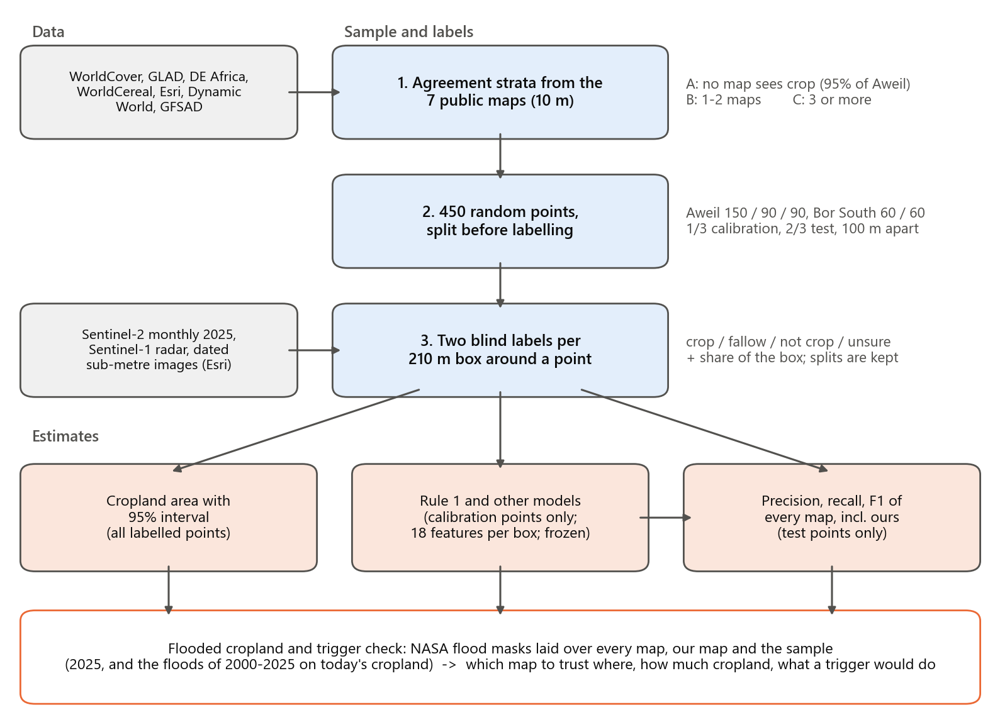

*Figure 3. The approach. The sample is drawn from strata of map agreement and labelled twice; the labels give the area, train our models (calibration points) and score every map (test points); flood masks are laid over all of them. The protocol was frozen before labelling; every later change is in a dated change log (Appendix J).*

## 5. Evaluation Methodology

Each part is judged on its own terms (Table 3). *Labels*: agreement and Cohen's kappa between the two labellers, with positive and negative specific agreement because crop is rare and kappa then misleads (Cohen, 1960; Cicchetti and Feinstein, 1990). *Area*: the estimate with its standard error and a 95% interval. *Maps*: precision, recall and F1 on test points only; maps whose intervals overlap are not ranked. Overall accuracy is never used to rank, because it rewards a map that finds nothing where crop is rare (Figure 4). *Use*: whether each map's flooded cropland gives the same trigger decision as the sample.

We checked the interval itself by simulating our exact design. The usual ±1.96 SE interval held the true area only 47%-94% of the time, every miss below the truth, because stratum A often holds no cropland point at all. We therefore also report an adjusted upper bound: per stratum at least the variance the stratum would have with one more cropland and one more empty box. It reached 94%-100% coverage in Aweil. *(pending decision 1)* The trigger check uses the same cautious bound, capped at the land that flooded. *(pending decision 8b)*

Two further measures address ZOA's wish for a cheap, local check: the number of points needed for a 20% coefficient of variation with our strata and with strata built from a single map (Adebayo et al., 2026), and the hours the labelling took. Qualitatively, we broke each map's errors down by what the labellers saw (land cover, crop cues, distance to buildings, share of the box) and looked at images of the worst errors.

*Table 3. Criteria for an adequate solution and how we measure them.*

| Criterion (from ZOA and ZHL) | Measure |
|---|---|
| State how certain we are | 95% intervals on area, standard errors on scores, simulated coverage |
| Misses and false alarms both cost | recall and precision reported separately |
| Relevant to the decision | trigger decisions per map against the sample |
| Transparent, interpretable | conditions and features of Rule 1; F1 lost against a black box |
| Local, and cheap to repeat | scores per area; points and hours a yearly check needs |
| Whose farmland is seen | recall per map; errors by distance to buildings and field size |

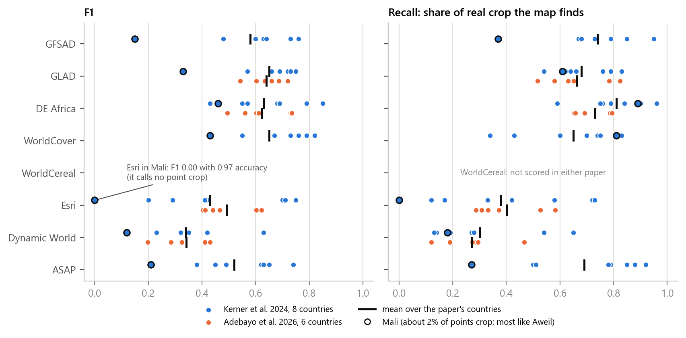

*Figure 4. F1 and recall of the maps we compare, as published for other African countries (Kerner et al., 2024; Adebayo et al., 2026). Ringed: Mali, where Esri has 0.97 accuracy and an F1 of 0.00.*

## 6. Results

**Labels.** On all 450 points the two blind labellers agreed on cropland versus not at 85.6% (Cohen's kappa 0.70; Aweil 83.3%, kappa 0.68). In Bor South agreement was high but almost only on "not crop" (kappa 0.14): the few boxes anyone called cropland were rarely confirmed. At 41 of the 53 points where they split, one labeller saw field shapes and the other did not. They disagreed about whether a field is there, hardly ever about the land cover. Fallow was used 7 times in 900 labels, so "cropland" and "cropped in 2025" differ by less than 0.1 percentage point; we report cropland.

**Cropland area.** In the Aweil counties, 3.8% of the land is cropland: 116,500 ha, with a 95% interval of 76,700-183,100 ha (Table 5). Every public map counts less: between 0.22% and 1.92% of the land, or 6%-51% of the sample's estimate (Figure 5). In Bor South, cropland is rare: 0.38% of the land, 5,400 ha (1,000-16,500). There the maps scatter around it, from almost none to Dynamic World's 9.0%, 23 times the sample's estimate. Boxes that hold any cropland cover 14.3% of Aweil and 1.5% of Bor South: fields are small and scattered, which is why pixel counts and box counts differ so much.

**Map accuracy.** On the 186 Aweil test points (Figure 6), F1 ranges from 0.03 (Dynamic World 2025) and 0.06 (Esri 2025) to 0.55 (WorldCereal 2021). Esri, WorldCover, GLAD and ASAP have a precision of 1.00 but a recall of only 0.03-0.28: when they say crop they are right, but they miss most fields. Dynamic World is low on both (precision 0.10, recall 0.02). The recall of WorldCover, GLAD, GFSAD and Dynamic World is below every value published for them elsewhere in Africa. Rule 1 reaches an F1 of 0.72 (0.55-0.90; precision 0.70, recall 0.75). Its interval overlaps those of WorldCereal, DE Africa, ASAP, GLAD and WorldCover, so by our own rule it is not ranked above them; it is clearly above Esri, Dynamic World and GFSAD. The random forests (0.71-0.76) are not clearly better, and the logistic regressions are not better either (0.61-0.66): they find more fields (recall 0.84) but call more empty land crop (precision 0.48-0.54). *(pending decision 2)* In cross-validation on the calibration points, trees (0.85-0.86) and logistic regressions (0.87-0.88) were just as close. In Bor South none of the 74 test points both labellers agree on is cropland, so recall cannot be computed; Dynamic World calls crop on 44 of the 74 boxes where the labellers saw no field, and the other maps on at most one.

**The models.** Rule 1 learned two questions (Figure 7): is there a building within 333 m of the box, and does the box show field edges? Of the 40 calibration boxes that pass both, 39 hold a cropped field; of the 79 boxes far from any building, 2. On the test points, which it had never seen, the questions hold up: 93 of the 98 boxes it calls crop are cropland, and only 3 of the 149 boxes far from buildings are (Figure 15). In cross-validation on the calibration points all models scored alike: trees 0.85-0.86, logistic regressions 0.87-0.88, the random forest 0.92 (Figure 8, Table 10). On the test points every model scores lower, between 0.61 and 0.76, with overlapping intervals. Two things explain the drop: cross-validation counts every point alike, while the test scores weigh each point by the land it stands for, so a false crop in stratum A (95% of Aweil) weighs heavily; and with 41 crop points the calibration scores are themselves uncertain. What the models learned agrees (Figure 16). Distance to the nearest building is the strongest input of the logistic model (-0.85 log-odds per standard deviation), followed by June radar (-0.85; lower over cropland, likely because fields are freshly sown and bare, Figure 14) and the harvest drop (+0.64). In the random forest, distance to buildings carries 0.23 of the importance and field edges 0.14. Cropland in Aweil is homestead cropland, and every model finds it there. Our answer to "trees or logistic regression?" is that it matters little here; we keep the two-question tree because local staff can read and check it. *(pending decision 2)*

**Where maps fail.** Rule 1's false crop lies within 250 m of buildings and its missed crop mostly farther away: it is, in effect, a "fields around homesteads" rule. The logistic models make more false crop in stratum A (9-12 of 122 empty test boxes, against 5 for Rule 1), where most of the land is, which is why their precision drops. Dynamic World's false crop in Bor South is open land where the labellers saw no field: grassland.

**Our map, and the whole country.** Counted over its own pixels, our map marks 22.6% of the Aweil counties (the stratified estimate from the 330 labelled points: 16.3%), more than the 14.3% of land whose box holds cropland in the sample: it over-marks, mostly boxes near homesteads without a field, as its precision of 0.70 says. In Bor South it marks 1.2%. Applied to the whole country at 30 m, it marks 6.8% of South Sudan (about 4,280,000 ha, an upper bound) and agrees with the 10 m map where both exist (Aweil 23.6%). Outside our two areas it is not checked. Per state it ranks the land much like the crop assessment (rank correlation 0.52; the public maps -0.36 to 0.25, GFSAD 0.59), but it marks Unity high and Western Equatoria low, where a rule learned around Aweil's homesteads fits least (Appendix H).

Is the national run as good as the 10 m map? On the Aweil test points it gives the same answer at 96% of the boxes and keeps its recall (0.75), but where the two differ it marks empty boxes: precision falls to 0.50 and F1 to 0.60 (against 0.72 at 10 m; Table 15). Coarser pixels see field edges less sharply. Outside our two areas our map is not checked: there are no labels there. We can only compare it with the public maps, at 20,000 random points outside our areas (Table 17). This measures agreement, not accuracy. Of the land at least two public maps call crop, our map marks 29%. That share is high where the farming resembles Aweil's: 96% in Warrap, Aweil's neighbour, and 83% in Lakes. It is low in Upper Nile (2%, where the public maps see crop on 13% of the land) and in Eastern Equatoria (7%). There, fields lie far from homesteads, as large schemes or along rivers, or follow two rainy seasons, and a rule learned around Aweil's homesteads misses them. Our map should not be used there without new labels.

**Flooded cropland.** In 2025, 10,314 ha of the Aweil counties flooded at least one day, and the public maps put 10-307 ha of cropland under water. In Bor South 29,419 ha flooded; every public map shows at most 10 ha of flooded cropland except Dynamic World, with 1,606 ha. The sample cannot say which is right: only 1 of the 330 Aweil points and 2 of the 120 Bor South points lie on flooded land, so in 2025 it "cannot tell" at any trigger threshold from 100 to 5,000 ha. *(pending decision 8b)* This is a negative result about our design, not about the maps.

Past floods give the sample more to work with (Figure 9). *(pending decision 8c)* In 9 of the 26 years enough sample points lie on flooded land in Aweil, and in every one of them the sample puts 4-16 times more of today's cropland under water than the median public map. For a flood like 2022 (53,646 ha flooded; 9 of the 11 sample points on flooded land hold cropland) the sample estimates 7,263 ha (639-14,336), against 331-3,572 ha by the public maps. Played back as a trigger, the sample confirms a 500 ha trigger in 2008 and 2022; with Esri, GLAD or WorldCover that trigger would have stayed silent in 2022. Figure 10 shows where: WorldCereal shows crop in 1,646 of the 10,184 flooded cells of 2022, and our map adds 3,627, along the Lol and in the east of the area.

**Exposure before and after.** Table 4 sets the numbers ZOA would have used side by side with the ones after our check. In the 2022 flood the public maps put 331-3,572 ha of Aweil's cropland under water; the labelled sample puts 7,263 ha there (639-14,336). As an illustration of what that means for a funding request, we divide by the 0.77 ha of cereal per farming household that the 2025 crop assessment gives for Aweil, and count every flooded field as lost: 430-4,660 farming households before the check, about 9,470 (830-18,700) after. A request sized on any one map would have been several times too small. The 2008 flood shows the same pattern. In Bor South the error runs the other way: in 2007 none of the five sample points on flooded land held cropland, while Dynamic World put enough cropland under water to fire even a 5,000 ha trigger. In 2025 the sample cannot judge either area. These are upper bounds on exposure; how much of a flooded field is lost depends on flood timing and crop stage.

*Table 4. Flooded cropland before and after our check, on today's cropland: the public maps against the labelled sample (ratio estimator, 95% interval; judged only with at least five sample points on flooded land). Households: hectares divided by the cereal hectares per farming household in the 2025 crop assessment (illustrative and an upper bound: every flooded field counted as lost). Trigger: flooded cropland of at least 500 ha.*

| Area | Year | Flooded | Maps, ha | Sample, ha | Hh., maps | Hh., sample | Maps fire | Sample |
|---|---|---|---|---|---|---|---|---|
| Aweil | 2008 | 83,017 | 585-4,335 | 10,795 (1,862-19,729) | 760-5,650 | 14,080 | 8 of 8 | fire |
| Aweil | 2022 | 53,646 | 331-3,572 | 7,263 (639-14,336) | 430-4,660 | 9,470 | 5 of 8 | fire |
| Aweil | 2025 | 10,322 | 10-306 | cannot tell (1 point) | 10-400 | - | 0 of 8 | cannot tell |
| Bor South | 2007 | 35,057 | 0-9,479 | 0 (0-2,096) | 0-12,150 | 0 | 1 of 8 | cannot tell |
| Bor South | 2025 | 29,435 | 0-1,600 | cannot tell (2 points) | 0-2,050 | - | 1 of 8 | cannot tell |

**Cost of a check.** With our strata, a 20% coefficient of variation on Aweil's area needs about 124 points; strata from a single public map need 112-149, depending on the map. Our design is not clearly cheaper than one built on the best single map, but it does not depend on choosing that map beforehand. Bor South would need about 1,240 points under any design: cropland is too rare there for a sample of 120. Labelling took a median of 0.5-1.0 minutes per point and 2.7-7.3 hours per person for 180 points.

*Table 5. Cropland area in 2025 from the labelled sample: estimate and 95% interval (lower bound as usual, upper bound adjusted).*

|  | Aweil counties (3,085,318 ha) share of land | ha | Bor South (1,396,328 ha) share of land | ha |
|---|---|---|---|---|
| Cropland (cropped or fallow) | 3.8% (2.5%-5.9%) | 116,500 | 0.38% (0.07%-1.2%) | 5,400 |
| Upper bound: box holds cropland | 14.3% |  | 1.5% |  |
| CFSAM 2025 cereal area (modelled) | 3.6% | 111,500 | 1.9% | 26,000 |

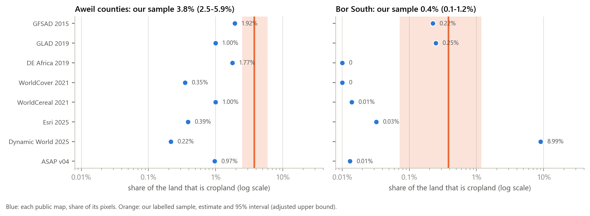

*Figure 5. Share of the land that is cropland: each public map (pixel count, blue) against our labelled sample (estimate and 95% interval, orange).*

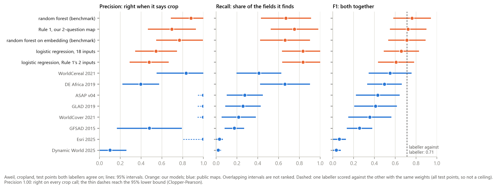

*Figure 6. Precision, recall and F1 of every map on the Aweil test points, with 95% intervals. Orange: our models; blue: public maps; dashed: agreement between the two labellers (0.86).*

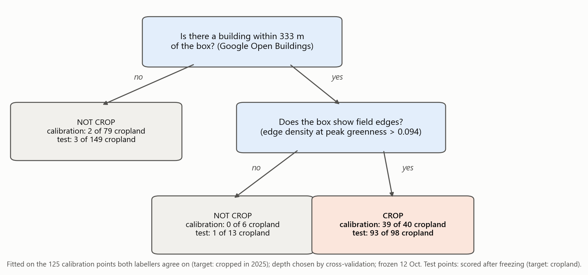

*Figure 7. Rule 1 as a two-question tree, with the calibration points it learned from and the test points it was scored on (both areas; unweighted counts). Frozen on 12 October 2026, before any test label was read.*

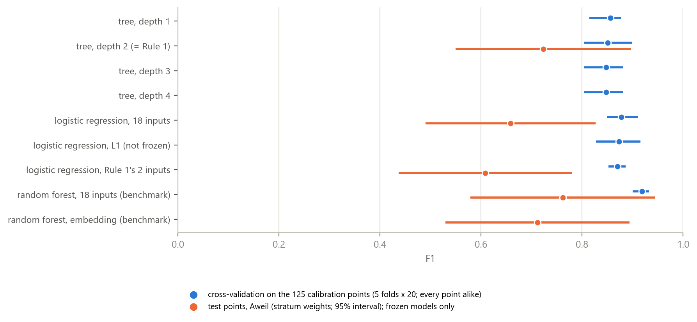

*Figure 8. Every model's F1 in repeated cross-validation on the calibration points (blue) and on the Aweil test points (orange, frozen models only, 95% intervals). The two scores are not comparable in level: cross-validation counts every point alike, the test weighs points by the land they stand for.*

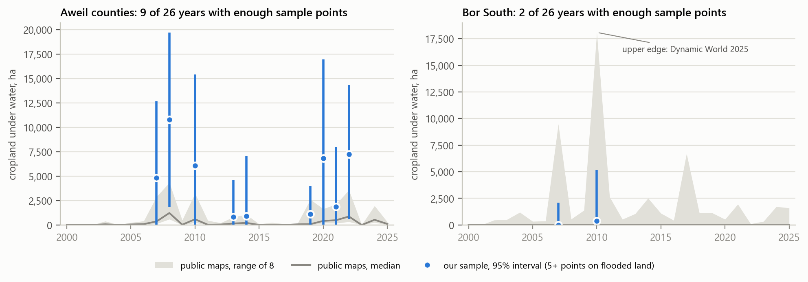

*Figure 9. Today's cropland under every flood of 2000-2025: the public maps as a range with their median, our labelled sample with 95% intervals in the years with at least five sample points on flooded land.*

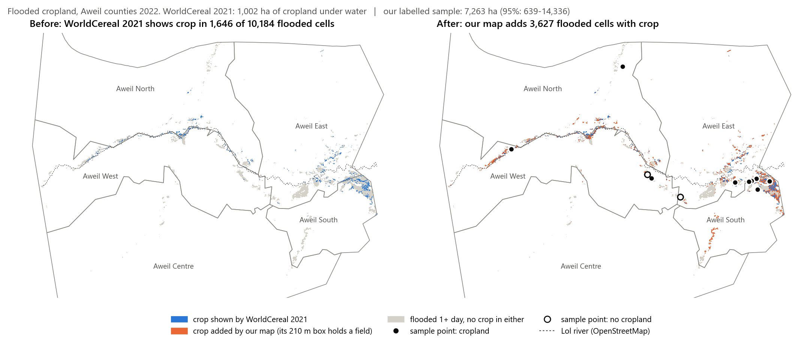

*Figure 10. The 2022 flood in the Aweil counties, cell by cell (232 m). Left: flooded cells where WorldCereal 2021, the best public map on our test points, shows crop. Right: the cells our map adds, and the sample points on flooded land.*

> **Idea.** Too many figures for 2,000 words. Suggestion: keep Figures 3, 6, 7 and 9 and Table 5 in the text; move 5, 2 and 10 to the poster; move 1, 4 and 8 to the appendix (appendices do not count towards the words, check the course rule).

## 7. Discussion

**What it means for ZOA.** The public maps miss most fields in Aweil, and a trigger built on them would stay silent in exactly the floods that matter: the 2022 scenario shows a 500 ha trigger that Esri, GLAD or WorldCover would not have fired. Overall accuracy would not have warned anyone; recall does. For ZOA this gives three practical rules: never choose a map by its overall accuracy; in Aweil use WorldCereal or our map and avoid Esri and Dynamic World; in Bor South avoid Dynamic World, which calls open grassland crop. The cropland area itself should come from a labelled sample with its interval, not from any map.

**An outside check.** The FAO/WFP crop assessment models cereal area from population and household figures, independently of any image. In Aweil its 111,500 ha fall inside our interval and close to our estimate of 116,500 ha, while every public map is below both. In Bor South its 26,000 ha lie above our upper bound. Possible reasons: flood-recession plots planted after the water drops, which a 2025 image may not show as fields; few cropland points in a sample of 120; and an assessment that models rather than measures. Bor South needs more points before any number there is firm.

**Errors in the reference data.** Our reference is not free of error, and the labellers' own account adds to what the numbers show (Appendix B). They judged fields partly on sub-metre images of another year or of unknown date (Esri Wayback, Google Maps), which can show a field that was opened or abandoned since; the 2025 decision rested on the Sentinel-2 cues, but this cannot be ruled out. They did not all use the same extra sources: some opened single Sentinel-2 scenes in a browser for more dates per month, so two labellers did not always see the same evidence, which is part of their disagreement. One labeller counted cropland just outside the box in a few early labels and then stopped; two labels say so in their notes. Such a label counts only when the second labeller confirms it; otherwise it is a split, left out of every score and counted half in the area. If all 44 split points in Aweil were in truth empty, the share of land whose box holds cropland would fall from 14.3% to 10.3%; if all held cropland, it would rise to 18.3%. The share of the box is given in classes, so a box with 1% and one with 9% cropland both count 5%. And fallow in 2025 looks like grass from space: labellers called it in only 7 of 900 labels, so some fallow is likely labelled "not crop", which lowers our cropland area and the precision of maps that count fallow (GLAD, GFSAD, Esri).

**Strengths and weaknesses.** The estimates rest on a probability sample with known inclusion probabilities, labelled twice and blind, with a protocol frozen before labelling and a model frozen before testing. The weaknesses are as clear. The reference is what people see on images, not on the ground; two careful labellers disagree on one point in seven, mostly on whether a small field is there. One season and two areas. Few cropland test points in Bor South and in stratum A, which widens every interval. The 210 m box makes our map an upper bound on location: it shows where fields are near, not their exact edges. Some analyses were added after the first results were known (logistic models, the flood scenario and its minimum of five points); they are marked as such and never changed a frozen result.

**What we hand over.** Beyond the numbers, we deliver the means to repeat and extend them (Appendix I): the labelling tool and its key, with which two people label a box blind in about a minute; a configuration file and a guide that move the whole pipeline to another area, country or season; the sampling, scoring and flood scripts; a workbench in which a next group fits and freezes a model on calibration points only; a results dashboard in one HTML file that opens without internet; and the 450 labelled boxes with their features and every map's value, as training and test data for better models. The next steps follow in that order: label boxes outside our two areas before our map is used there, add a flood-prone stratum, then fit models per region on the larger set.

**Is the objective met?** Sub-objective 1 is met: an area with an interval that does not depend on any map. Sub-objective 2 is met in Aweil and only partly in Bor South, where recall cannot be computed. Sub-objective 3 is met: a two-condition rule that local staff can read scores as well as the black boxes. Sub-objective 4 is met for the maps and for big past floods, but not for the small 2025 flood, where the sample has almost no points on flooded land.

**Positive and negative impacts.** Used well, the check means fewer silent misses where maps under-count fields, fewer false alarms where a map calls grassland crop, numbers with a stated uncertainty, and a check cheap enough to repeat each season. It also carries risks. A checked number for two areas can be read as valid everywhere; our national map is not checked outside them. The sample gives area, not location, so targeting still needs a map and local knowledge. Improving the map in ZOA's areas does nothing for farmers elsewhere. In a conflict setting, maps of who farms where can touch land claims, so they should be shared at the level ZOA needs and no further.

## 8. Conclusion

In ZOA's two areas, the public cropland maps do not show the farmland a flood trigger depends on. In the Aweil counties, 3.8% of the land is cropland (116,500 ha, 76,700-183,100), while every public map shows 0.22%-1.92%. Most maps find only a small part of the fields, and two of them, Esri and Dynamic World, find almost none. In big floods, a trigger built on such maps would see a fraction of the cropland under water and stay silent. A small labelled sample, labelled twice and blind, gives an honest number and tells which map to trust where; a two-condition rule built from it does as well as the best alternatives we tried.

We recommend that ZOA (1) base the cropland part of a trigger on a labelled sample with its interval, with extra points on flood-prone land so that flooded cropland gets its own estimate; (2) choose maps by recall and precision in its own areas, never by overall accuracy: WorldCereal or our map in Aweil, not Esri or Dynamic World, and not Dynamic World in Bor South; (3) repeat the check each season, about 150 points or a few hours per labeller, with the tool and configuration we provide for other areas; (4) collect a few field points with its own staff to check the labels; and (5) use our national map outside Aweil only where new labels confirm it, and not at all in landscapes unlike Aweil's, such as Upper Nile and Eastern Equatoria. Next steps for research are crop stage and flood duration, which decide how much of a flooded field is lost.

## References

- ZOA International; Zero Hunger Lab (2026). JBG060 Q&A 2: Flood dynamics in South Sudan. Stakeholder slides, 21 September 2026
- Pacetti, Tommaso; Caporali, Enrica; Rulli, Maria Cristina (2017). Floods and food security: A method to estimate the effect of inundation on crops availability. Advances in Water Resources
- Kerner, Hannah; Nakalembe, Catherine; Yang, Adam; Zvonkov, Ivan; McWeeny, Ryan; Tseng, Gabriel; Becker-Reshef, Inbal (2024). How accurate are existing land cover maps for agriculture in Sub-Saharan Africa?. Scientific Data
- Adebayo, Adebowale Daniel; Nakalembe, Catherine; Skakun, Sergii; Frimpong, Diana Botchway; Ginsburg, Alana; Gadhiya, Yash Hitesh; Adjei, Monica; Kerner, Hannah; Becker-Reshef, Inbal (2026). Optimizing satellite-based cropland area estimation through integrated map accuracy assessment and stratified sampling design across six African countries. International Journal of Applied Earth Observation and Geoinformation
- Anticipation Hub (2023). A short overview of anticipatory action. Anticipation Hub, German Red Cross
- Olofsson, Pontus; Foody, Giles M.; Herold, Martin; Stehman, Stephen V.; Woodcock, Curtis E.; Wulder, Michael A. (2014). Good practices for estimating area and assessing accuracy of land change. Remote Sensing of Environment
- Stehman, Stephen V. (2014). Estimating area and map accuracy for stratified random sampling when the strata are different from the map classes. International Journal of Remote Sensing
- NASA LANCE (2025). MODIS Aqua+Terra Global Flood Product MCDWD L3 NRT.
- Fritz, Steffen et al. (2024). Development of a new cropland and rangeland area fraction image at 500 m for the ASAP system. Publications Office of the European Union
- Zanaga, Daniele et al. (2022). ESA WorldCover 10 m 2021 v200. Zenodo
- Potapov, Peter; Turubanova, Svetlana; Hansen, Matthew C.; Tyukavina, Alexandra; Zalles, Viviana; Khan, Ahmad; Song, Xiao-Peng; Pickens, Amy; Shen, Quan; Cortez, Jocelyn (2022). Global maps of cropland extent and change show accelerated cropland expansion in the twenty-first century. Nature Food
- Burton, Chad et al. (2022). Co-production of a 10-m cropland extent map for continental Africa using Sentinel-2, cloud computing, and the open-data-cube. Authorea preprint
- Van Tricht, Kristof et al. (2023). WorldCereal: a dynamic open-source system for global-scale, seasonal, and reproducible crop and irrigation mapping. Earth System Science Data
- Karra, Krishna et al. (2021). Global land use/land cover with Sentinel 2 and deep learning.
- Brown, Christopher F. et al. (2022). Dynamic World, near real-time global 10 m land use land cover mapping. Scientific Data
- Thenkabail, Prasad S. et al. (2021). Global cropland-extent product at 30-m resolution (GCEP30) derived from Landsat satellite time-series data for the year 2015 using multiple machine-learning algorithms on Google Earth Engine cloud. U.S. Geological Survey
- FAO; WFP (2023). Special Report: 2022 FAO/WFP Crop and Food Security Assessment Mission to the Republic of South Sudan. FAO
- FAO; WFP (2026). Special Report: 2025 FAO/WFP Crop and Food Security Assessment Mission to the Republic of South Sudan. FAO
- Cohen, Jacob (1960). A coefficient of agreement for nominal scales. Educational and Psychological Measurement
- Cicchetti, Domenic V.; Feinstein, Alvan R. (1990). High agreement but low kappa: II. Resolving the paradoxes. Journal of Clinical Epidemiology

## Appendix A. Data, sample and labels

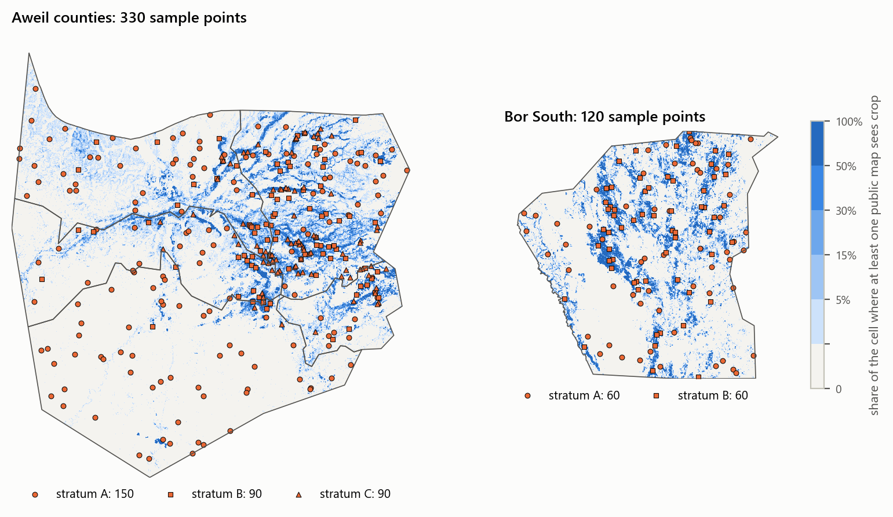

*Figure 11. The strata and the 450 sample points. Shading: share of each 232 m cell where at least one of the seven public maps sees crop (stratum A where none does). Markers: sample points by stratum. In Bor South stratum C was smaller than 0.1% of the area and was merged into B before drawing.*

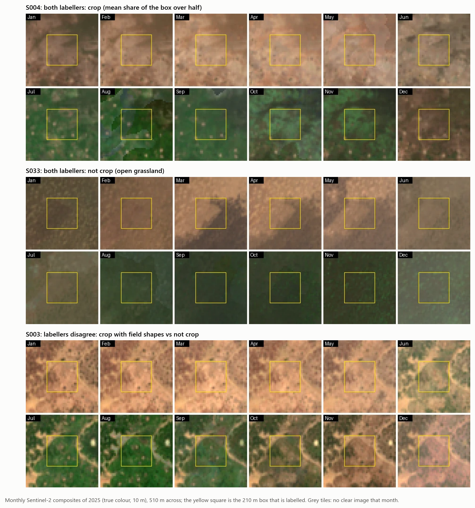

*Figure 12. What the labellers see: twelve monthly Sentinel-2 images of 2025 around a point, with the 210 m box to label (yellow), for a box both called crop, a box both called not crop, and a box on which they disagreed. In the tool, each point also has a radar curve, a greenness curve per patch of the box and a dated sub-metre image.*

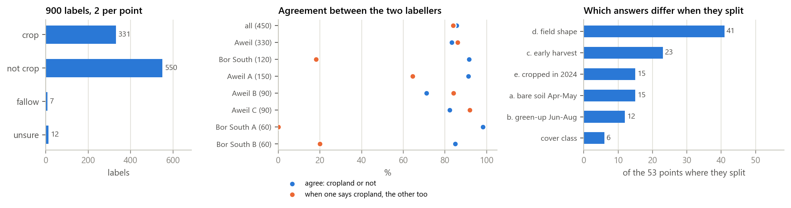

*Figure 13. Our labels: the 900 labels, agreement between the two labellers per area and stratum, and which answers differ when they split (mostly whether field shapes are visible).*

*Table 6. Strata and sample. Cropland: points both labellers call cropland; split: the two labellers disagree.*

| Area | Stratum | ha | Share | Points | Calib. | Test | Cropland | Split |
|---|---|---|---|---|---|---|---|---|
| Aweil | A | 2,929,918 | 95.0% | 150 | 50 | 100 | 10 | 13 |
| Aweil | B | 145,327 | 4.7% | 90 | 30 | 60 | 53 | 26 |
| Aweil | C | 9,934 | 0.3% | 90 | 30 | 60 | 74 | 16 |
| Bor South | A | 1,264,445 | 90.6% | 60 | 20 | 40 | 0 | 1 |
| Bor South | B | 131,838 | 9.4% | 60 | 20 | 40 | 1 | 9 |

*Table 7. Agreement between the two blind labellers on cropland versus not, per area and stratum.*

| Group | Points | Agree | Kappa | Pos. agr. | Neg. agr. |
|---|---|---|---|---|---|
| All | 450 | 85.6% | 0.70 | 0.84 | 0.90 |
| Aweil | 330 | 83.3% | 0.68 | 0.86 | 0.86 |
| Bor South | 120 | 91.7% | 0.14 | 0.18 | 0.96 |
| Aweil A | 150 | 91.3% | 0.58 | 0.65 | 0.96 |
| Aweil B | 90 | 71.1% | 0.32 | 0.84 | 0.52 |
| Aweil C | 90 | 82.2% | -0.07 | 0.92 | 0.00 |
| Bor South A | 60 | 98.3% | 0.00 | 0.00 | 0.99 |
| Bor South B | 60 | 85.0% | 0.16 | 0.20 | 0.93 |

## Appendix B. Known errors in the data

We asked the labellers after labelling how they worked. Table 8 lists every error source we know of in the reference labels and the other data, the direction it pushes the results, and how the method contains it. None of them was corrected after the fact: changing labels after the scores are known would bias the check more than the errors themselves.

*Table 8. Known errors in the data, their likely effect, and how the method contains them.*

| Source | What happened | Likely effect | How it is contained |
|---|---|---|---|
| Image dates | Sub-metre images were often not from 2025: the tool flags Esri's date, Esri Wayback shows older captures, and Google Maps (used for its sharper images and zoom) shows no date at all. | A field opened or left since then can be read as a 2025 field, or missed. | The key: older images for field shapes only, the 2025 decision from the Sentinel-2 cues. The labellers called Google "not binding". Not measurable. |
| Different sources | Some labellers also opened single Sentinel-2 scenes in a browser (more dates per month) or Esri Wayback; others mostly used the tool's monthly images. | Two labellers do not always see the same evidence; more disagreement. | Disagreements are kept: left out of scoring, counted half in the area. Kappa 0.70 includes this. |
| Box edge | In a few early labels one labeller counted cropland just outside the box, then stopped (notes on two labels: one became a split, one inflated the share of an agreed calibration box). | Cropland presence and share too high. | Counts only if the second labeller agrees. Bound: Aweil box share 10.3%-18.3% if all splits were empty or cropland. |
| Share classes | The share of the box is a class (none, under 10, 10-25, 25-50, over 50%), turned into its middle. | Rounding either way; matters most where few boxes hold crop (Bor South). | Averaged over two labellers and many boxes; the presence measure does not use it. |
| Fallow | In 2025 a fallow field looks like grass; "fallow" was used 7 times in 900 labels. | Cropland area too low; maps that count fallow look less precise. | Reported for both definitions; they differ by under 0.1 percentage point. |
| Clouds | Few clear Sentinel-2 images in June-September; no radar pass over Aweil in January-April 2025. | The green-up cue is harder to see. | A radar curve for the cloudy months; "unsure" allowed and left out. |
| No ground visit | The reference is what five students see on images, after a written key and a 30-point pilot. | Unknown; small fields in grass are the hardest. | Two blind labellers per box; a field check by ZOA staff recommended. |
| Labeller drift | Practice changed during labelling (the box-edge case). | Early labels a little different from late ones. | Labeller pairs balanced over areas, strata and splits, so drift does not pile up in one stratum. |
| Flood masks | MODIS cells of 232 m, daily; cloud gaps are not flagged; short floods and rain waterlogging can be missed. | Flooded land, and so every exposure number, too low. | The same flood layer for every map and the sample, so comparisons are fair; absolute hectares are a lower bound on flooded land. |
| Cropland in past years | Past floods are overlaid on today's cropland (labels and our map of 2025; public maps of their own year). | A scenario, not a hindcast of real cropland. | Said wherever past floods are used. |

## Appendix C. Features and models

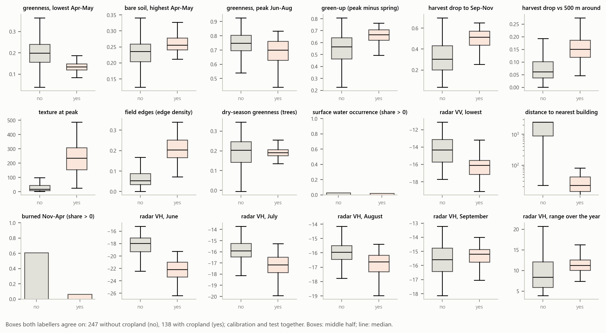

*Figure 14. The 18 features for boxes with and without cropland (all points both labellers agree on). Cropland boxes are near buildings, have field edges and texture, a stronger harvest drop and lower radar in June, and are rarely burned.*

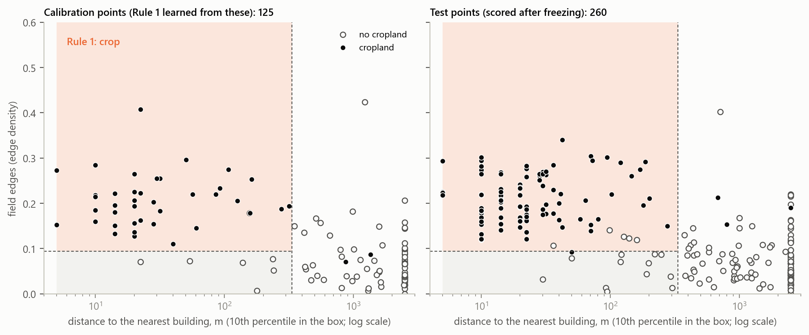

*Figure 15. Every agreed point on Rule 1's two inputs. Orange area: where Rule 1 says crop (a building within 333 m and field edges above 0.094). Left: the calibration points it was fitted on; right: the test points it was scored on after freezing.*

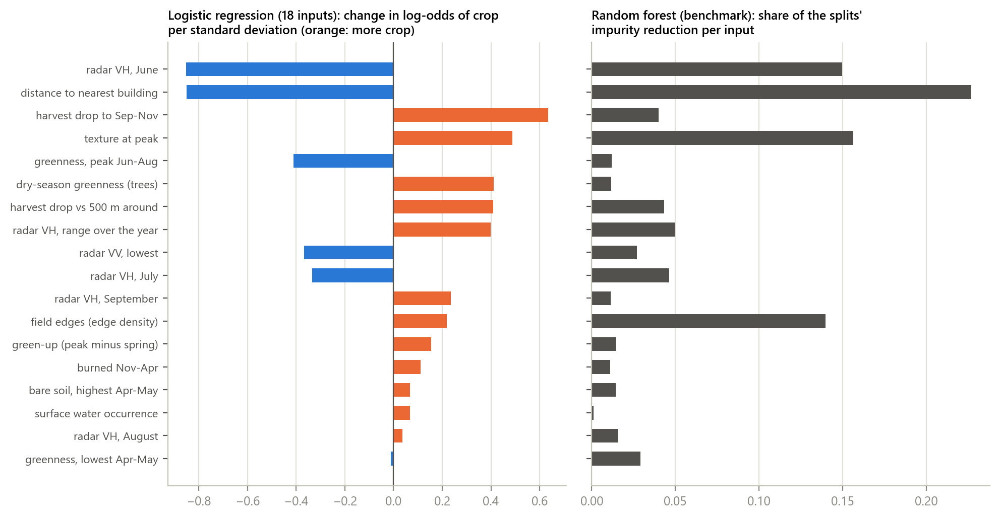

*Figure 16. What the models learned from the same 18 inputs: the logistic regression's coefficients (change in log-odds of crop per standard deviation; orange: more crop) and the random forest's importances.*

*Table 9. The 18 features. Each is computed per 10 m pixel for 2025 and summarised over the 210 m box by its most crop-like part.*

| Feature | What it measures | Cue | Over the box |
|---|---|---|---|
| ndvi_min_am | greenness, lowest April-May | a: bare soil before sowing | 10th pct. |
| bsi_max_am | bare-soil index, highest April-May | a: bare soil before sowing | 90th pct. |
| ndvi_peak_jja | greenness, peak June-August | b: green-up | mean |
| greenup | peak minus spring greenness | b: green-up | 90th pct. |
| drop_son | drop from the peak to September-November | c: harvest | 90th pct. |
| drop_vs_500m | that drop minus the 500 m surroundings' | c: harvest earlier than the grass | 90th pct. |
| texture_jja | texture (GLCM contrast) at the peak | d: field shape | 90th pct. |
| edge_density | edge density (Canny edges) at the peak | d: field shape | 90th pct. |
| ndvi_min_jfm | greenness, lowest January-March | trees and shrub | mean |
| water_occurrence | JRC surface water occurrence | water | mean |
| s1_vv_min | radar VV, lowest month | water | mean |
| dist_buildings_m | distance to the nearest building (m) | homesteads | 10th pct. |
| burned | burned November-April | burn scars | mean |
| vh_jun | radar VH, June | cloudy months | mean |
| vh_jul | radar VH, July | cloudy months | mean |
| vh_aug | radar VH, August | cloudy months | mean |
| vh_sep | radar VH, September | cloudy months | mean |
| vh_range | radar VH, range over the year | cloudy months | mean |

*Table 10. Models: F1 in repeated cross-validation on the 125 calibration points (every point alike; 2.5-97.5% of 20 repeats) and on the Aweil test points (stratum weights; 95% interval; frozen models only).*

| Model | Cross-validation | Test |
|---|---|---|
| tree, depth 1 | 0.86 (0.81-0.88) | - |
| tree, depth 2 (= Rule 1) | 0.85 (0.80-0.90) | 0.72 (0.55-0.90) |
| tree, depth 3 | 0.85 (0.80-0.88) | - |
| tree, depth 4 | 0.85 (0.80-0.88) | - |
| logistic regression, 18 inputs | 0.88 (0.85-0.91) | 0.66 (0.49-0.83) |
| logistic regression, L1 (not frozen) | 0.87 (0.83-0.92) | - |
| logistic regression, Rule 1's 2 inputs | 0.87 (0.85-0.89) | 0.61 (0.44-0.78) |
| random forest, 18 inputs (benchmark) | 0.92 (0.90-0.93) | 0.76 (0.58-0.94) |
| random forest, embedding (benchmark) | - | 0.71 (0.53-0.89) |

## Appendix D. Map accuracy in detail

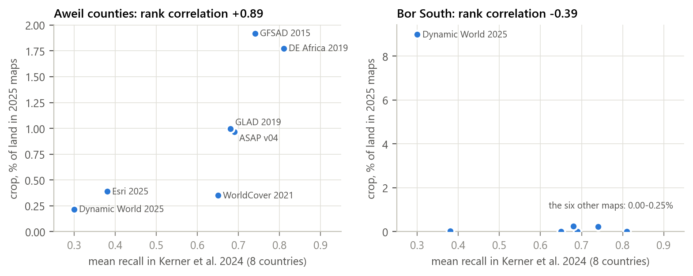

*Figure 17. Published recall of each map against the crop share it shows in our areas. The published scores predict which maps show least crop in Aweil, not in Bor South.*

*Table 11. Accuracy of every map on the Aweil test points (cropland; stratified estimators; ± one standard error).*

| Map | Year | Precision | Recall | F1 | Overall acc. |
|---|---|---|---|---|---|
| random forest, 18 inputs | 2025 (benchmark) | 0.88 ± 0.10 | 0.67 ± 0.12 | 0.76 ± 0.09 | 0.95 |
| Rule 1 (ours) | 2025 (ours) | 0.70 ± 0.12 | 0.75 ± 0.12 | 0.72 ± 0.09 | 0.93 |
| random forest, embedding | 2025 (benchmark) | 0.77 ± 0.11 | 0.66 ± 0.12 | 0.71 ± 0.09 | 0.93 |
| logistic regression, 18 inputs | 2025 (model) | 0.54 ± 0.10 | 0.84 ± 0.10 | 0.66 ± 0.09 | 0.89 |
| logistic regression, 2 inputs | 2025 (model) | 0.48 ± 0.10 | 0.84 ± 0.10 | 0.61 ± 0.09 | 0.86 |
| WorldCereal 2021 | 2021 | 0.83 ± 0.14 | 0.41 ± 0.11 | 0.55 ± 0.11 | 0.91 |
| DE Africa 2019 | 2019 | 0.40 ± 0.09 | 0.66 ± 0.12 | 0.50 ± 0.08 | 0.83 |
| ASAP v04 | 2017-23 | 1.00 ± 0.00 | 0.28 ± 0.09 | 0.43 ± 0.11 | 0.91 |
| GLAD 2019 | 2019 | 1.00 ± 0.00 | 0.26 ± 0.09 | 0.41 ± 0.10 | 0.91 |
| WorldCover 2021 | 2021 | 1.00 ± 0.00 | 0.22 ± 0.08 | 0.36 ± 0.11 | 0.90 |
| GFSAD 2015 | 2015 | 0.48 ± 0.16 | 0.18 ± 0.05 | 0.26 ± 0.06 | 0.87 |
| Esri 2025 | 2025 | 1.00 ± 0.00 | 0.03 ± 0.02 | 0.06 ± 0.03 | 0.88 |
| Dynamic World 2025 | 2025 | 0.10 ± 0.08 | 0.02 ± 0.01 | 0.03 ± 0.02 | 0.85 |

*Table 12. Our scores in Aweil against the range published for the same maps in other African countries (Kerner et al.\ 2024; Adebayo et al.\ 2026).*

| Map | Recall, ours | Recall, published | F1, ours | F1, published |
|---|---|---|---|---|
| ASAP v04 | 0.28 | 0.27-0.92 | 0.43 | 0.21-0.74 |
| DE Africa 2019 | 0.66 | 0.59-0.96 | 0.50 | 0.43-0.85 |
| Dynamic World 2025 | 0.02 | 0.12-0.65 | 0.03 | 0.12-0.63 |
| Esri 2025 | 0.03 | 0.00-0.73 | 0.06 | 0.00-0.75 |
| GFSAD 2015 | 0.18 | 0.37-0.95 | 0.26 | 0.15-0.76 |
| GLAD 2019 | 0.26 | 0.52-0.83 | 0.41 | 0.33-0.75 |
| WorldCover 2021 | 0.22 | 0.34-0.83 | 0.36 | 0.43-0.82 |

## Appendix E. Area, interval and sampling design

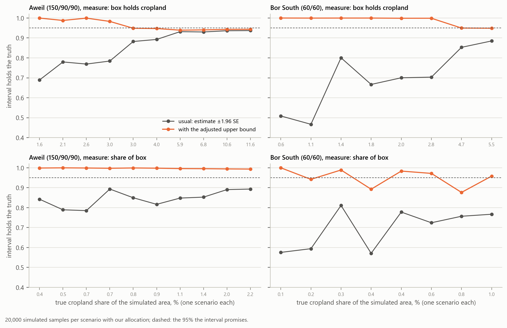

*Figure 18. How often the interval holds the true area, in 20,000 simulated samples of our exact design per scenario. The usual interval falls short when cropland is rare in stratum A; with the adjusted upper bound coverage is close to or above 95%. *(pending decision 1)**

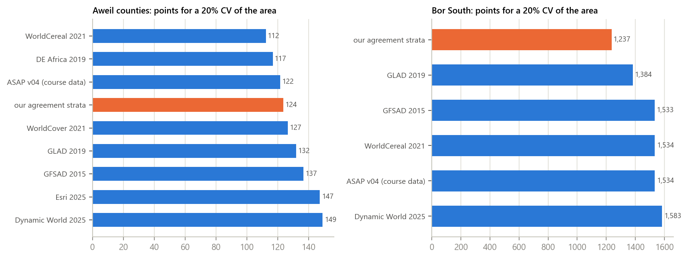

*Figure 19. Points needed for a 20% coefficient of variation of the area: our agreement strata (orange) against strata built from a single public map (blue), estimated from our sample.*

## Appendix F. The public maps

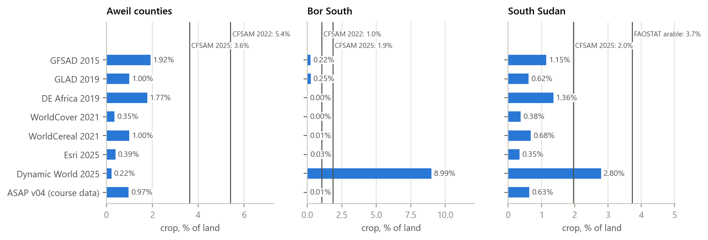

*Figure 20. Share of the land each public map calls crop, in the five Aweil counties, in Bor South and in South Sudan. Lines: FAO/WFP cereal harvested area (modelled) and FAOSTAT arable land.*

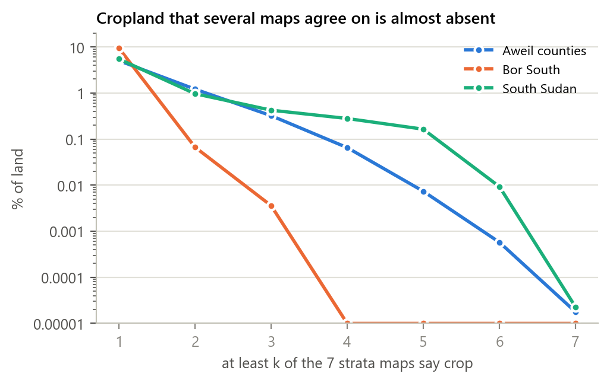

*Figure 21. Share of the land that at least k of the seven maps call crop (log scale). Bor South has no land where four or more agree.*

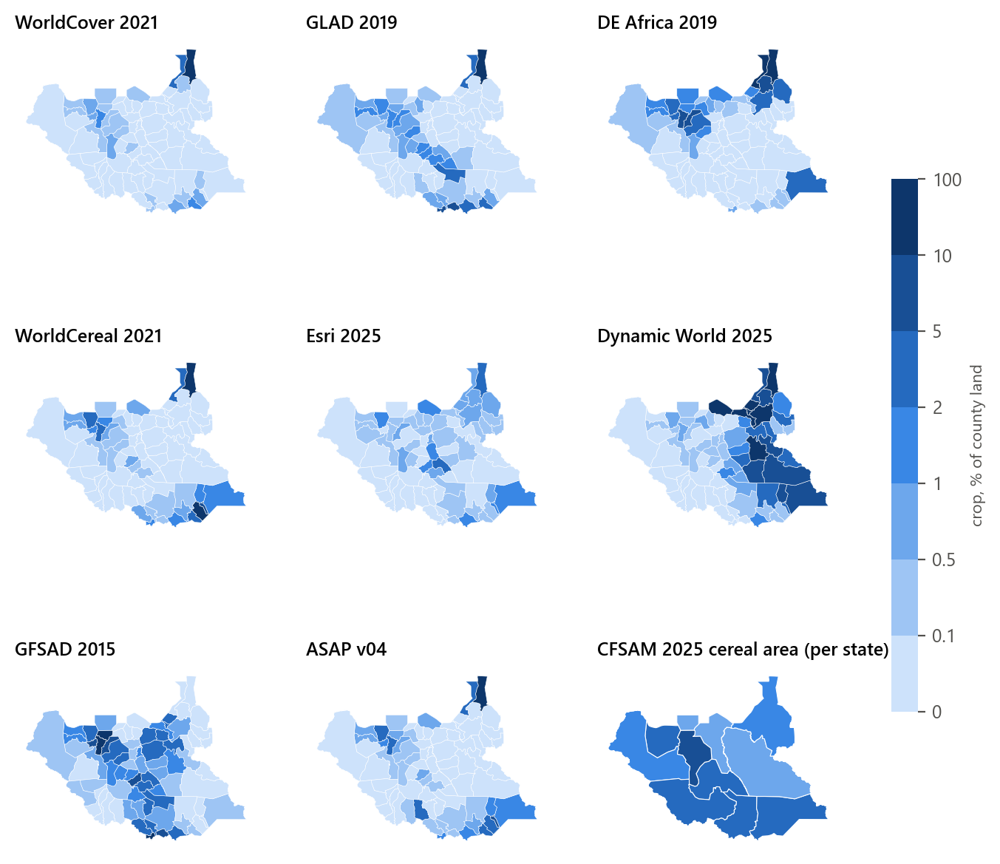

*Figure 22. Where each map puts South Sudan's cropland: crop share per county per map, and the crop assessment's 2025 cereal area per state.*

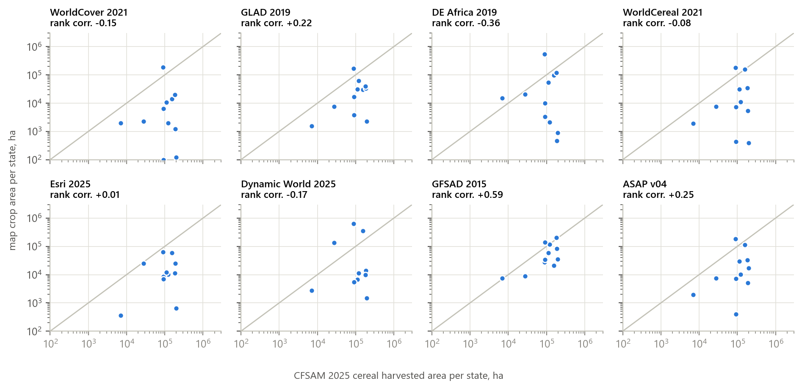

*Figure 23. Crop area per state by each map against the 2025 crop assessment (line: 1 to 1), with each map's rank correlation.*

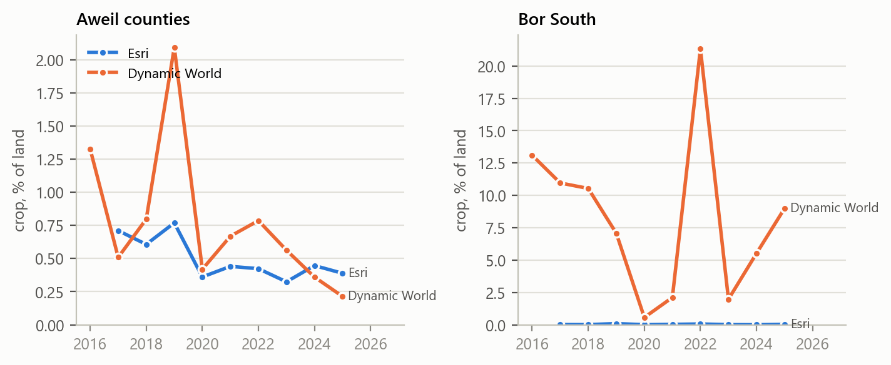

*Figure 24. The same product in different years: Esri (2017-2025) and Dynamic World (2016-2025). Dynamic World changes by a factor of 10 in Aweil and 37 in Bor South.*

## Appendix G. Floods

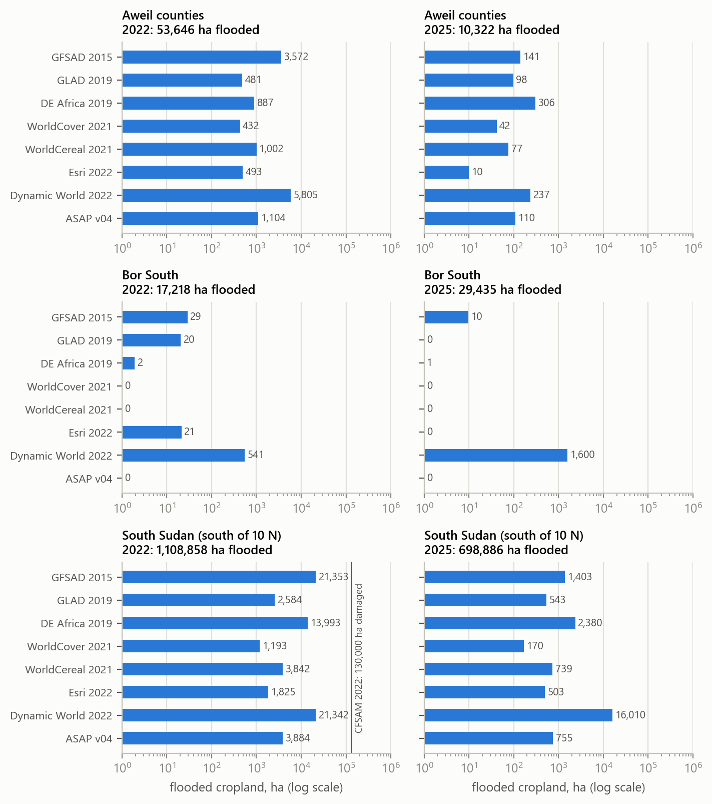

*Figure 25. Cropland under the NASA flood extent (June-December) per map, 2022 and 2025; line: the 2022 crop assessment's flood-damaged area.*

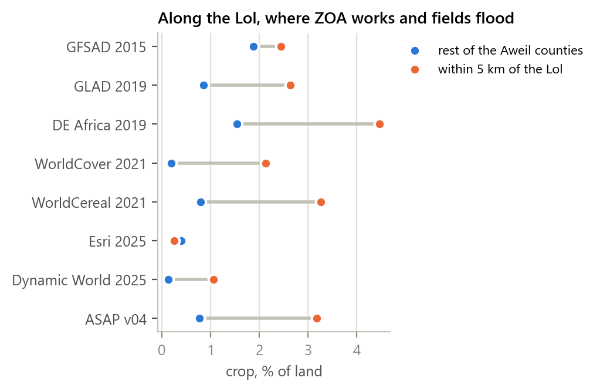

*Figure 26. Along the Lol: crop share within 5 km of the river against the rest of the Aweil counties, per map.*

*Table 13. Past floods on today's cropland: the years with at least five sample points on flooded land (1+ flood day, June-December). Maps: lowest / median / highest of the 8 public layers; sample: ratio estimator, 95% interval.*

| Area | Year | Flooded ha | Points | Cropland | Maps (ha) | Sample (ha) |
|---|---|---|---|---|---|---|
| Aweil | 2007 | 43,871 | 6 | 4 | 122 / 364 / 2,900 | 4,811 (0-12,679) |
| Aweil | 2008 | 83,017 | 17 | 13 | 585 / 1,226 / 4,335 | 10,795 (1,862-19,729) |
| Aweil | 2010 | 58,939 | 12 | 10 | 225 / 585 / 3,215 | 6,093 (0-15,419) |
| Aweil | 2013 | 23,991 | 7 | 3 | 9 / 151 / 817 | 818 (0-4,564) |
| Aweil | 2014 | 31,438 | 5 | 3 | 51 / 215 / 1,068 | 913 (0-7,028) |
| Aweil | 2019 | 16,787 | 6 | 3 | 15 / 87 / 2,604 | 1,105 (0-4,016) |
| Aweil | 2020 | 62,569 | 9 | 5 | 186 / 417 / 1,645 | 6,817 (0-16,978) |
| Aweil | 2021 | 41,636 | 9 | 6 | 169 / 489 / 2,123 | 1,879 (0-7,984) |
| Aweil | 2022 | 53,646 | 11 | 9 | 331 / 869 / 3,572 | 7,263 (639-14,336) |
| Bor South | 2007 | 35,057 | 5 | 0 | 0 / 1 / 9,479 | 0 (0-2,096) |
| Bor South | 2010 | 115,198 | 11 | 1 | 0 / 0 / 18,094 | 358 (0-5,154) |

*Table 14. Trigger hindcast, Aweil, 2000-2025: years in which each layer's flooded cropland reaches the threshold (fires), and in how many of the years the sample can judge it agrees with the sample.*

| Layer | 100 ha: fires | agrees | 500 ha: fires | agrees | 1,000 ha: fires | agrees |
|---|---|---|---|---|---|---|
| ASAP v04 | 10 | 2/2 | 5 | 2/2 | 2 | 1/1 |
| DE Africa 2019 | 12 | 2/2 | 5 | 2/2 | 1 | 1/1 |
| Dynamic World 2022 | 24 | 2/2 | 20 | 2/2 | 20 | 1/1 |
| Dynamic World 2025 | 19 | 2/2 | 7 | 2/2 | 2 | 1/1 |
| Esri 2022 | 16 | 2/2 | 6 | 1/2 | 3 | 1/1 |
| Esri 2025 | 14 | 2/2 | 4 | 1/2 | 0 | 0/1 |
| GFSAD 2015 | 18 | 2/2 | 10 | 2/2 | 9 | 1/1 |
| GLAD 2019 | 7 | 2/2 | 1 | 1/2 | 0 | 0/1 |
| Rule 1 (ours) | 23 | - | 17 | - | 15 | - |
| WorldCereal 2021 | 8 | 2/2 | 4 | 2/2 | 2 | 1/1 |
| WorldCover 2021 | 8 | 2/2 | 1 | 1/2 | 0 | 0/1 |

## Appendix H. Our map over the whole country

Rule 1 was run over all of South Sudan at 30 m (Earth Engine export of 12 October), as a map of land whose 210 m box holds a field. Table 15 compares it on the Aweil test points with the 10 m map and the public maps; Table 16 gives its share per state. Outside the study areas there are no labels, so the map's accuracy there is unknown. Table 17 compares it with the public maps instead, at 20,000 points drawn uniformly at random (by area, seed 42) over the country without the six study counties. At each point we read our map's 30 m pixel and each public map's 10 m pixel. Because our map means "a field within 210 m" and a public map "this pixel is crop", ours marks more land by design; the useful number is the share of the land the public maps agree is crop that our map also marks. This is agreement between maps, not accuracy: where they all miss the same fields, agreement is high and all are wrong.

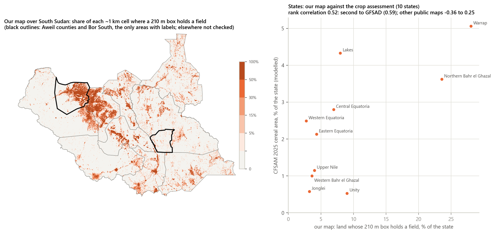

*Figure 27. Our map applied to all of South Sudan (30 m), shown as the share of each 1 km cell where a 210 m box holds a field. Only the outlined areas have labels; elsewhere the map is not checked. Right: per state against the crop assessment's modelled cereal area.*

*Table 15. Our map at 10 m and its 30 m national run on the 186 Aweil test points, next to the public maps (cropland; stratified estimators; ± one standard error).*

| Map | Precision | Recall | F1 |
|---|---|---|---|
| Rule 1, 10 m map | 0.70 ± 0.12 | 0.75 ± 0.12 | 0.72 ± 0.09 |
| Rule 1, 30 m national run | 0.50 ± 0.10 | 0.75 ± 0.12 | 0.60 ± 0.09 |
| WorldCereal 2021 | 0.83 ± 0.14 | 0.41 ± 0.11 | 0.55 ± 0.11 |
| DE Africa 2019 | 0.40 ± 0.09 | 0.66 ± 0.12 | 0.50 ± 0.08 |
| ASAP v04 | 1.00 ± 0.00 | 0.28 ± 0.09 | 0.43 ± 0.11 |
| GLAD 2019 | 1.00 ± 0.00 | 0.26 ± 0.09 | 0.41 ± 0.10 |
| WorldCover 2021 | 1.00 ± 0.00 | 0.22 ± 0.08 | 0.36 ± 0.11 |
| GFSAD 2015 | 0.48 ± 0.16 | 0.18 ± 0.05 | 0.26 ± 0.06 |
| Esri 2025 | 1.00 ± 0.00 | 0.03 ± 0.02 | 0.06 ± 0.03 |
| Dynamic World 2025 | 0.10 ± 0.08 | 0.02 ± 0.01 | 0.03 ± 0.02 |

*Table 16. Our map over South Sudan per state (land whose 210 m box holds a field; an upper bound, not checked outside Aweil and Bor South) against the 2025 crop assessment's modelled cereal area.*

| State | Our map, % | Our map, ha | CFSAM cereal, % | CFSAM cereal, ha |
|---|---|---|---|---|
| Warrap | 28.0 | 1,005,557 | 5.1 | 181,463 |
| Northern Bahr el Ghazal | 23.6 | 727,425 | 3.6 | 111,530 |
| Unity | 9.0 | 333,378 | 0.5 | 19,698 |
| Lakes | 8.0 | 344,345 | 4.3 | 186,953 |
| Central Equatoria | 7.0 | 299,372 | 2.8 | 120,600 |
| Eastern Equatoria | 4.3 | 317,193 | 2.1 | 155,634 |
| Upper Nile | 4.0 | 310,106 | 1.1 | 88,816 |
| Western Bahr el Ghazal | 3.6 | 331,245 | 1.0 | 91,504 |
| Jonglei | 3.2 | 393,768 | 0.6 | 70,829 |
| Western Equatoria | 2.7 | 215,620 | 2.5 | 196,380 |

*Table 17. Without labels: our national map against the public maps at 20,000 uniform random points outside the study areas (our map's 30 m pixel; each public map's 10 m pixel at the point). Agreement, not accuracy. Shares in % of the land; "of 2+ maps": of the land at least two public maps call crop, the share our map marks (- with fewer than five such points).*

| State | Points | Our map | Any public map | Ours, of any | Ours, of 2+ maps | Any, of ours |
|---|---|---|---|---|---|---|
| All (outside our areas) | 20,000 | 5.7 | 5.5 | 21 | 29 | 21 |
| Abyei Region | 338 | 0.0 | 2.4 | 0 | - | - |
| Central Equatoria | 1,432 | 6.6 | 4.7 | 33 | 67 | 23 |
| Eastern Equatoria | 2,447 | 4.2 | 8.4 | 11 | 7 | 21 |
| Jonglei | 3,630 | 3.2 | 6.2 | 8 | - | 17 |
| Lakes | 1,442 | 7.8 | 2.6 | 63 | 83 | 21 |
| Unity | 1,212 | 9.2 | 4.5 | 28 | 60 | 13 |
| Upper Nile | 2,626 | 3.1 | 13.3 | 5 | 2 | 21 |
| Warrap | 1,188 | 29.6 | 9.2 | 87 | 96 | 27 |
| Western Bahr el Ghazal | 3,010 | 3.5 | 0.8 | 56 | 71 | 13 |
| Western Equatoria | 2,675 | 2.5 | 0.5 | 54 | - | 10 |

## Appendix I. Tools for future work

Everything is in the repository: the pipeline in the folder `cropland/`, the report kit next to this report. `METHODOLOGY.md` holds the protocol with its dated change log, `REUSE.md` the guide for a new area, country or season.

*Table 18. What we hand over, what it is for, and where to start.*

| Tool | What it is for | Files, and how to start |
|---|---|---|
| Labelling tool | two people label each 210 m box blind, from monthly Sentinel-2 strips, a radar curve and a dated sub-metre image, with a written key; one CSV per person | `label_tool/`, `label_server.py`, `LABELLING_GUIDE.md`; run `label_server.py` |
| Reuse kit | the whole pipeline for another area, country or season from one configuration file (boundaries, crop calendar, maps, points per stratum, cue texts) | `config/TEMPLATE.toml`, `make_new_area.py`, `REUSE.md` |
| Sampling and estimates | strata from map agreement, the stratified sample, labeller pairs, and estimators with an interval for every area and score | steps `03`-`11`, `estimators.py`, `evaluation.py` |
| Model workbench | fit a tree or a logistic model on calibration points only, freeze it as a JSON file, map it in Earth Engine, score it once | `tree_workbench.ipynb`, `07_fit_rules.py`, `12_other_models.py`, `rules.py` |
| Flood overlay | any frozen model against NASA's flood masks 2000-2025: flooded cropland per year, the trigger hindcast, the before / after map | `10_flood.py`, `10b_flood_history.py`, `10c_flood_map.py` |
| National map | our map over South Sudan, its accuracy on our test points and its agreement with the public maps | `national_map.py`, `national_check.py` (the random points) |
| Results dashboard | one HTML file with the results story (area, map accuracy, exposure, trigger, country, tools); opens without internet | `14_dashboard.py`, `dashboard/template.html`; output `dashboard.html` |
| Report kit | every number and table of this report generated from the result files | `build_report_inputs.py` |
| Labelled data | 450 boxes, two blind labels each, 18 features and every map's value per box: training and test data | `sample.csv`, `labels_final.csv`, `model_table.csv` |

A next group can build on this in five steps. (1) Label boxes outside our two areas, drawn as a stratified sample with the same tool and key, to measure our map and every public map there. (2) Add a flood-prone stratum of about 100 boxes on land that floods often, so that flooded cropland gets its own estimate. (3) Fit better models on the larger set of calibration points, for example one per region with a two-season calendar for Greater Equatoria; freeze each before scoring it, and log it. (4) Repeat the check each season: about 150 boxes, one working day for two people. (5) Rebuild the dashboard and these tables with one command each. What stays fixed is what makes the numbers trustworthy: two blind labellers per box, no third person settling their disagreements, the presence rule on the 210 m box, models fitted on calibration points only and frozen before the test labels are read, and stratified estimators with an interval for every number.

## Appendix J. Protocol and its changes

The protocol (`cropland/METHODOLOGY.md`) was frozen before labelling on 3 October 2026. Every later change is dated there with its reason; in short:

- 30 September (when the sample was drawn): season 2025; fallow counts as cropland; one readable model (Rule 1) instead of hand-written rules; strata from seven maps.

- 4-5 October (before any point was labelled): the unit became the 210 m box; the share of the box was added; disagreements are kept, never settled by a third person; labeller pairs balanced per stratum and split.

- 12 October, after Rule 1 was frozen and before any test label was read: the adjusted upper bound of the area interval *(pending decision 1)* and the evaluation additions (error analysis, trigger agreement, published scores, design efficiency).

- 12 October, after the first test scores: the two logistic regressions, chosen on the calibration points only *(pending decision 2)*; a fix for months without radar passes, which changed no feature value; the configuration for other areas.

- 14 October: the flood results; the cautious bound for the sample's flooded cropland *(pending decision 8b)*; past floods on today's cropland with a ratio estimator and at least five points on flooded land *(pending decision 8c)*.

- 14 October, evening: the 30 m national map scored on the test points (a check, no model changed); our map compared with the public maps at 20,000 random points outside our areas, without labels (agreement, not accuracy); the group decided not to label further.
